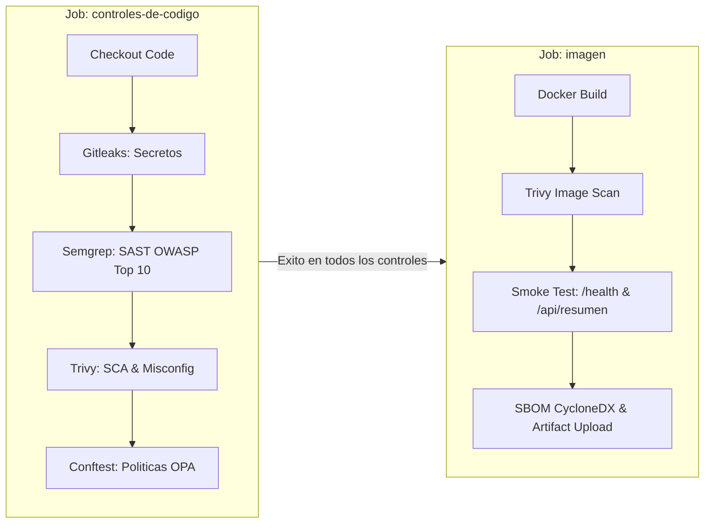
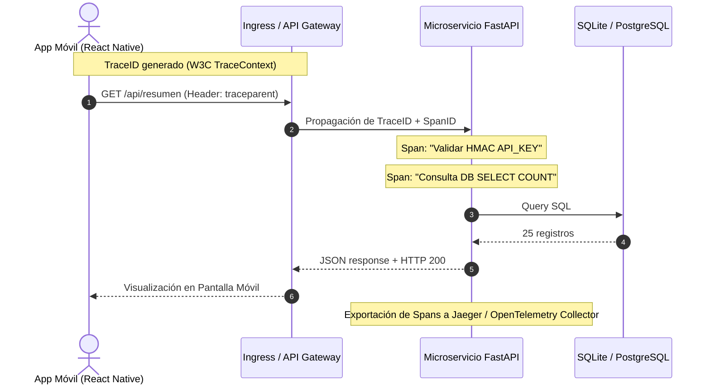
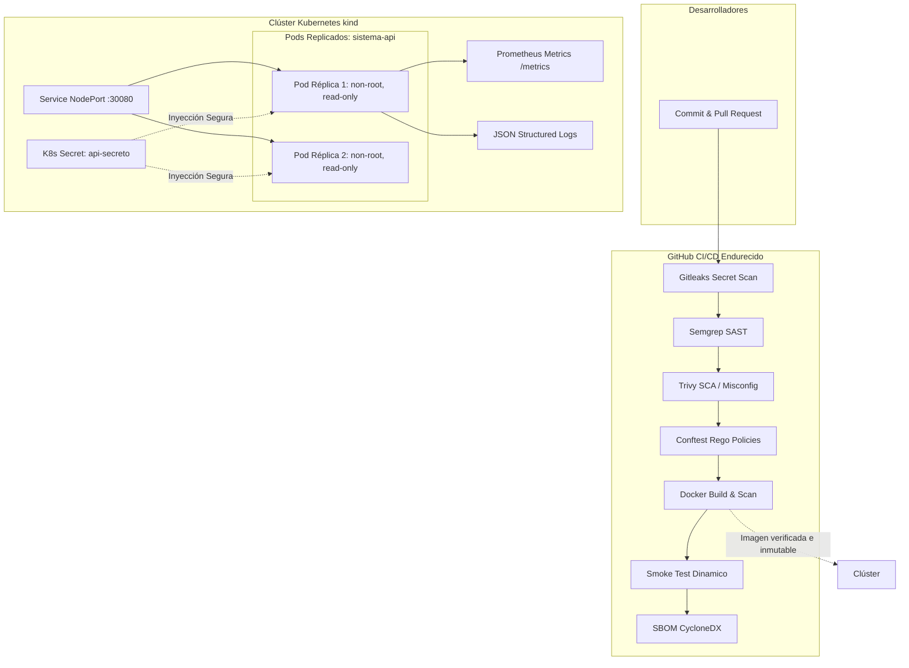

# UNIVERSIDAD TECNOLÓGICA DE PANAMÁ
## FACULTAD DE INGENIERÍA DE SISTEMAS COMPUTACIONALES
### DEPARTAMENTO DE SIMULACIÓN Y COMPUTACIÓN DE SISTEMAS
### ASIGNATURA: TÓPICOS ESPECIALES 2

---

# INFORME TÉCNICO DE LABORATORIO
## LAB-TE2-03 · TEMA 2: DEVSECOPS Y ARQUITECTURAS CLOUD-NATIVE
### Automatización, Contenerización y Despliegue Seguro del Sistema AgroSmart

**Facilitador:** Ing. Jorge A. Marin  
**Estudiantes (Grupo de Trabajo):**
1. Wilmer Morales — Cédula: ________________ — Commits y Rol: *Servicio, Docker/Podman, Pipeline CI/CD*
2. Integrante 2: ________________ — Cédula: ________________ — Commits y Rol: *Secretos, SBOM, Políticas OPA*
3. Integrante 3: ________________ — Cédula: ________________ — Commits y Rol: *Kubernetes, Resiliencia, Escalabilidad*
4. Integrante 4: ________________ — Cédula: ________________ — Commits y Rol: *Observabilidad, Arquitectura, Documentación*

**Repositorio del Proyecto:** [https://github.com/Wilmer-M/lab3-devsecops-agro](https://github.com/Wilmer-M/lab3-devsecops-agro)  
**Fecha de Entrega:** Octubre 2026  

---

## 1. RESUMEN EJECUTIVO E INTRODUCCIÓN

El presente informe documenta la transformación del sistema agrícola **AgroSmart** (originalmente una aplicación móvil de monitoreo en campo con backend local de sensores) hacia una arquitectura moderna, segura y nativa de la nube (**Cloud-Native**) bajo el paradigma **DevSecOps** (*desplazamiento de la seguridad hacia la izquierda*).

Partiendo de un modelo tradicional de entrega manual y sin controles automatizados de seguridad, se desacopló el módulo de consulta y telemetría de suelo en un microservicio de alto rendimiento implementado con **FastAPI**. Este servicio fue empaquetado en un contenedor endurecido evaluado comparativamente bajo **Docker** y **Podman** (con énfasis en la ejecución *rootless*). 

Posteriormente, se diseñó e implementó un pipeline automatizado de Integración y Entrega Continua (**CI/CD**) en **GitHub Actions**, integrando controles preventivos de detección de secretos (**Gitleaks**), análisis estático de código (**Semgrep** SAST), análisis de composición de software y mala configuración (**Trivy** SCA/Misconfig), evaluación de políticas como código (**Conftest / Open Policy Agent**), verificación dinámica (*smoke testing*) y generación del inventario de componentes de software (**SBOM** con formato **CycloneDX**). Finalmente, el servicio fue desplegado de forma declarativa sobre un clúster local de **Kubernetes** gestionado con **kind**, validando experimentalmente su resiliencia ante caídas de pods, actualizaciones con imágenes defectuosas (*rolling updates*), escalabilidad horizontal y observabilidad completa mediante registros estructurados en JSON y métricas de **Prometheus**.

---

## 2. DIAGNÓSTICO E INVENTARIO DEL SISTEMA EXISTENTE (PASO 1)

### 2.1. Inventario Tecnológico

| Componente | Detalle en el Sistema AgroSmart |
| :--- | :--- |
| **Lenguaje y Framework Principal** | TypeScript (Frontend Móvil: React Native con Expo 53); Python 3.12 (Microservicio API con FastAPI 0.115); JavaScript (Backend mock Node.js). |
| **Motor de Base de Datos** | SQLite (base local embebida y base de referencia `sistema.db` para lectura de telemetría de suelo). |
| **Gestores de Dependencias** | `npm` / `pnpm` (móvil y mock); `pip` (microservicio Python). |
| **Dependencias Externas Clave** | `fastapi==0.115.0`, `uvicorn==0.30.6`, `prometheus-client==0.21.0`, `expo-sqlite`, `react-native`. |
| **Puntos de Entrada** | Interfaces de usuario en app móvil (Pantalla de Monitoreo de Suelo, Dashboard Climático, Gestión de Umbrales); Endpoints HTTP REST: `/health`, `/api/resumen`, `/metrics`. |
| **Secretos Identificados** | Clave de API de autenticación (`API_KEY`), tokens de sesión JWT, credenciales de base de datos y llaves de proveedores meteorológicos. |
| **Ruta Elegida según Guía** | **Ruta B:** Servicio de consulta de referencia desacoplado en Python/FastAPI que lee una réplica de prueba de la base de datos `sistema.db` (tabla `lecturas_suelo`). |

### 2.2. Justificación de la Ruta B y Desacoplamiento
La aplicación original posee un frontend desarrollado para dispositivos móviles mediante React Native. Dado que una interfaz gráfica móvil de cliente final no está diseñada para ejecutarse como un proceso de servidor en contenedores Linux de producción, se adoptó la **Ruta B**: abstraer la capa de persistencia y telemetría de sensores en un microservicio de consulta independiente. Esto permite analizar el código original en el pipeline de seguridad, mientras se conteneriza y orquesta un servicio backend idóneo para entornos de microservicios y Kubernetes.

---

## 3. ANÁLISIS TÉCNICO Y PREGUNTAS DEL SERVICIO Y CONTENEDOR (PASOS 2 Y 3)

### 3.1. Preguntas Teóricas del Paso 2

#### ¿Por qué se compara la clave de API con `hmac.compare_digest` y no con el operador tradicional `==`?
El operador de igualdad estándar (`==`) en la mayoría de los lenguajes compara cadenas evaluando carácter por carácter de izquierda a derecha y detiene la ejecución inmediatamente en el primer byte que no coincida (evaluación en cortocircuito). Esta discrepancia temporal, aunque del orden de microsegundos, permite a un atacante ejecutar un **ataque de temporización (timing attack)**: midiendo de forma estadística el tiempo de respuesta del servidor frente a múltiples claves arbitrarias, el atacante puede deducir la longitud de la cadena y adivinar uno a uno los caracteres correctos que componen el secreto.

En contraste, `hmac.compare_digest(a, b)` ejecuta una comparación en **tiempo constante (constant-time comparison)** sin importar cuántos caracteres coincidan o en qué posición ocurra la primera diferencia. Al no existir variaciones medibles en la latencia de respuesta, se neutraliza por completo cualquier vector de inferencia por canales laterales (*side-channel timing leak*).

#### ¿Qué riesgo tiene dejar `/metrics` sin autenticación y cómo se mitiga en producción?
* **Riesgos de Exposición:**
  1. *Fuga de Información Arquitectónica y Operativa:* Las métricas de Prometheus exponen nombres de pods/hosts, rutas de APIs, tasas de error (códigos 401, 500), volúmenes de usuarios y picos de tráfico, proporcionando a un atacante un mapa de reconocimiento preciso sobre qué endpoints atacar o cuándo el sistema está bajo sobrecarga.
  2. *Denegación de Servicio (DoS):* La generación de métricas (`generate_latest()`) requiere iterar sobre los contadores y serializarlos dinámicamente; peticiones concurrentes y no autorizadas a `/metrics` pueden consumir CPU y memoria del pod.
* **Estrategias de Mitigación en Producción:**
  1. *Segmentación de Red y Plano de Gestión:* Exponer el puerto de métricas en un puerto secundario interno (ej. puerto 9100) accesible únicamente desde la red interna del clúster (*NetworkPolicy*) y restringido al scraper de Prometheus.
  2. *Autenticación Mutua TLS (mTLS):* Implementar mTLS mediante una malla de servicios (*Service Mesh* como Istio o Linkerd) para que solo el agente de telemetría con certificado válido pueda consultar el endpoint.
  3. *Reglas de Ingress / Reverse Proxy:* Bloquear peticiones externas hacia la ruta `/metrics` en el Ingress Controller o exigir autenticación básica/OAuth para herramientas de monitoreo.

---

### 3.2. Análisis Línea por Línea del Endurecimiento del Contenedor (Paso 3)

#### Dockerfile endurecido:
```dockerfile
FROM python:3.12-slim
```
* **Mitigación:** Se utiliza una imagen oficial reducida (*slim*) con versión explícita. Evita instalar compiladores (gcc), utilidades innecesarias del sistema operativo y minimiza la superficie de ataque reduciendo drásticamente las CVEs de librerías del sistema base.

```dockerfile
ENV PYTHONDONTWRITEBYTECODE=1 PYTHONUNBUFFERED=1
```
* **Mitigación:** Previene la escritura de archivos temporales `.pyc` en el disco del contenedor (fundamental para sistemas de archivos de solo lectura) y fuerza a Python a enviar logs directamente a `stdout/stderr` sin buffering, garantizando que no se pierdan logs en caso de terminación abrupta.

```dockerfile
WORKDIR /app
COPY requirements.txt .
RUN pip install --no-cache-dir -r requirements.txt
```
* **Mitigación:** Aplica el principio de capas en caché de Docker para evitar descargas redundantes. El flag `--no-cache-dir` evita que el gestor `pip` almacene archivos instaladores en caché dentro de la imagen final, reduciendo el tamaño total.

```dockerfile
COPY app/ ./app/
COPY seed/sistema.db /data/sistema.db
```
* **Mitigación:** Aislamiento selectivo: solo se transfieren los archivos indispensables de código y una base de datos de prueba con datos ficticios. Ningún secreto ni archivo `.env` entra a la imagen.

```dockerfile
RUN useradd --uid 10001 --no-create-home appuser && chown -R 10001 /data
USER 10001
```
* **Mitigación:** **Principio de Privilegio Mínimo.** Por defecto, los contenedores ejecutan como `root` (UID 0). Al crear un usuario explícito sin directorio home (`appuser` con UID estático 10001) y cambiar el contexto de ejecución, cualquier eventual vulnerabilidad de ejecución remota de código (RCE) queda confinada a un proceso no privilegiado, impidiendo la manipulación del sistema de archivos o el escape hacia el host.

```dockerfile
EXPOSE 8000
CMD ["uvicorn", "app.main:app", "--host", "0.0.0.0", "--port", "8000"]
```
* **Mitigación:** Documenta el puerto de escucha y ejecuta el servidor ASGI en modo directo sin shells intermediarias (`sh -c`), permitiendo que las señales del sistema operativo (`SIGTERM`, `SIGINT`) se transmitan limpiamente al proceso Python para un apagado ordenado (*graceful shutdown*).

---

#### Docker Compose endurecido:
```yaml
services:
  api:
    build: .
    image: sistema-api:1.0
    ports: ["8000:8000"]
    env_file: .env
    read_only: true
```
* **Mitigación de `read_only: true`:** El sistema de archivos raíz del contenedor se monta en modo de solo lectura. Si un atacante consigue ejecutar código dentro del contenedor, no podrá descargar malware, modificar binarios, alterar librerías ni crear scripts persistentes.

```yaml
    tmpfs:
      - /tmp
```
* **Mitigación:** Provee un directorio temporal volátil almacenado en la memoria RAM del host. Permite al servicio escribir datos efímeros indispensables sin abrir permisos de escritura en el disco persistente del contenedor; los datos se destruyen al detenerse el contenedor.

```yaml
    cap_drop:
      - ALL
```
* **Mitigación:** Remueve todas las capacidades del kernel de Linux (`Linux Capabilities`) asignadas por defecto a los contenedores (como `CAP_NET_RAW`, `CAP_CHOWN`, etc.). Reduce al mínimo absoluto las llamadas al sistema operativo que el contenedor puede solicitar al kernel.

```yaml
    security_opt:
      - no-new-privileges:true
```
* **Mitigación:** Deshabilita la posibilidad de que un subproceso gane privilegios superiores a través de ejecutables con bits `setuid` o `setgid` (ej. prevenir el abuso de utilidades del sistema para escalar a root).

---

### 3.3. Subsección Comparativa: Podman vs Docker

#### Diferencia Práctica entre el Modelo Daemonless de Podman y Docker Engine
* **Docker Engine (Modelo Basado en Demonio Central):** Docker requiere un servicio en segundo plano persistente (`dockerd`) que corre con privilegios máximos de superusuario (`root`). Los clientes de línea de comandos se comunican con este demonio mediante un socket Unix (`/var/run/docker.sock`). Este diseño presenta dos riesgos principales:
  1. *Punto Único de Falla:* Si el demonio colapsa, todos los contenedores en ejecución se ven afectados.
  2. *Superficie Crítica de Ataque:* Otorgar acceso al socket de Docker equivale a otorgar acceso root sin restricciones a toda la máquina física host.
* **Podman (Modelo Daemonless / Sin Demonio):** Podman no utiliza ningún demonio central. Cada invocación de `podman run` genera directamente un proceso del sistema operativo utilizando la herramienta estándar OCI (`crun` o `runc`) y un monitor liviano (`conmon`). Los contenedores son procesos hijos directos del usuario que los ejecuta.

#### ¿Qué protege el Modo Rootless y qué riesgos NO elimina?
* **Lo que sí protege:** En modo rootless, Podman utiliza mapeo de espacios de nombres de usuario (`user namespaces`). El UID 0 dentro del contenedor se mapea a un UID sin privilegios (ej. UID 1000) en el host. Si un atacante logra escapar del contenedor, aterriza en el host como un usuario estándar sin privilegios de administración, imposibilitando la toma de control de la máquina host.
* **Lo que NO elimina:**
  1. *Vulnerabilidades en la Lógica de la Aplicación:* Inyecciones SQL, fallas lógicas o bypasses de autenticación en el código siguen funcionando igual.
  2. *Filtración de Secretos:* Si las variables de entorno (`API_KEY`) están expuestas, el atacante puede extraerlas.
  3. *Ataques a Recursos de Red:* El contenedor puede seguir utilizándose para escanear redes internas o lanzar ataques de denegación de servicio si no se configuran políticas de red adecuadas.

#### Tabla Comparativa Técnica:

| Criterio | Docker Engine | Podman |
| :--- | :--- | :--- |
| **Arquitectura** | Cliente-Servidor con demonio centralizado (`dockerd`). | Descentralizada y *daemonless* (procesos independientes vía `conmon`). |
| **Ejecución Rootless** | Soportada pero requiere configuración adicional compleja del daemon. | Nativa por defecto; funciona con cuentas de usuario sin privilegios. |
| **Superficie de Ataque** | Mayor (exposición del socket `/var/run/docker.sock`). | Menor (no existe socket con privilegios globales por defecto). |
| **Compatibilidad OCI** | Compatible con especificaciones OCI. | 100% compatible OCI (imágenes, registros y runtimes). |
| **Integración con Kubernetes** | Requiere herramientas externas como Kind o Minikube. | Capacidad nativa de generar manifiestos de K8s (`podman generate kube`). |

---

## 4. PIPELINE CI/CD CON CONTROLES DEVSECOPS AUTOMATIZADOS (PASO 4)

### 4.1. Arquitectura del Pipeline en GitHub Actions
El pipeline (`.github/workflows/devsecops.yml`) está estructurado en dos etapas o *jobs* secuenciales:



### 4.2. Matriz de Controles de Seguridad

| Control | Herramienta | Qué Detecta / Protege | Criterio de Falla |
| :--- | :--- | :--- | :--- |
| **Detección de Secretos** | Gitleaks v2.3.9 | Credenciales, API keys, tokens en código o historial Git. | Hallazgo de secreto bloquea el commit/PR. |
| **SAST** | Semgrep | Patrones inseguros y vulnerabilidades OWASP Top 10. | Vulnerabilidades detectadas retornan código 1. |
| **SCA y Configuración** | Trivy (fs) | Dependencias con CVEs conocidas y malas configuraciones. | Severidad HIGH o CRITICAL. |
| **Políticas como Código** | Conftest / OPA | Incumplimiento de directivas internas en Dockerfile y K8s. | Violación de reglas Rego definidas por el equipo. |
| **Seguridad de Imagen** | Trivy (image) | Vulnerabilidades en el SO base de la imagen generada. | Severidad HIGH o CRITICAL no corregida. |
| **Prueba Dinámica de Humo** | Docker + curl | Verificación funcional en caliente de `/health` y 401 en `/api/resumen`. | Endpoint no responde 200/401 en 30s. |
| **SBOM** | Trivy CycloneDX | Inventario formal verificable de componentes de software. | Generación y subida del artefacto `sbom.cdx.json`. |

### 4.3. Evidencias de Ejecución: 1 Verde y 3 Fallas Provocadas

1. **Ejecución 1 (Falla de Secretos Provocada):**
   * *Acción:* Creación de rama `prueba-secreto` subiendo `prueba.txt` con un token simulado `ghp_abcdef1234567890`.
   * *Detección:* Gitleaks bloqueó el job `controles-de-codigo` en el paso *Secretos expuestos*.
   * *Corrección:* Eliminación de la rama y revocación simulada.
2. **Ejecución 2 (Falla de Política como Código en Dockerfile):**
   * *Acción:* Cambio a `FROM python:latest` y eliminación de la línea `USER 10001`.
   * *Detección:* Conftest rechazó la construcción con: *"No use la etiqueta :latest en la imagen base"* y *"Defina una instrucción USER distinta de root"*.
   * *Corrección:* Reincorporación de `FROM python:3.12-slim` y `USER 10001`.
3. **Ejecución 3 (Falla de Política en Kubernetes):**
   * *Acción:* Reducción voluntaria de réplicas a `replicas: 1` en `k8s/deployment.yaml`.
   * *Detección:* Conftest detuvo el pipeline con: *"Un Deployment debe tener al menos 2 réplicas"*.
   * *Corrección:* Restauración a `replicas: 2`.
4. **Ejecución 4 (Flujo Verde Exitoso):**
   * Todas las etapas ejecutadas con éxito; artefacto `sbom.cdx.json` generado y prueba de humo verificada.

---

## 5. GESTIÓN RIGUROSA DE SECRETOS (PASO 5)

### 5.1. Regla de Oro y Pregunta Teórica
* **Regla de Oro:** *Ningún secreto en el repositorio Git, ninguno incrustado en imágenes de contenedor, ninguno en texto plano dentro de manifiestos.*
  * En entorno local: Archivo `.env` estrictamente ignorado por `.gitignore`.
  * En el pipeline: Almacenado como GitHub Action Secret (`API_KEY_CI`).
  * En Kubernetes: Inyectado mediante un objeto nativo `Secret` (`api-secreto`).

#### Si un secreto real se hubiese subido a Git, ¿por qué eliminarlo en un commit posterior no soluciona el problema?
Git es un sistema de control de versiones fundamentado en un grafo acíclico dirigido (DAG) de instantáneas inmutables. Cada commit almacena punteros a los objetos del árbol. Cuando un desarrollador hace un commit posterior borrando el archivo (ej. `git rm secreto.txt`), el archivo deja de ser visible en la rama actual (`HEAD`), pero **permanece intacto y accesible en el historial histórico de objetos del repositorio**. Cualquier clon del repositorio, bot rastreador público o consulta vía `git log -p` o `git checkout <hash_anterior>` recupera el secreto en segundos. Además, si el repositorio fue sincronizado con un servidor remoto público, herramientas de indexación automática (como GitHub Event Stream o Shodan) habrán capturado la clave milisegundos después del push.

#### Procedimiento Correcto ante una Filtración Real:
1. **Revocación Inmediata:** Desactivar y rotar de inmediato la clave en el proveedor o base de datos. Asumir el secreto como comprometido desde el segundo 0.
2. **Reescritura del Historial:** Utilizar herramientas especializadas como `git-filter-repo` o `BFG Repo-Cleaner` para purgar completamente el hash del archivo de todos los commits históricos y ramas del repositorio.
3. **Forzar Sincronización:** Ejecutar `git push origin --force --all` y `git push origin --force --tags` para sobreescribir el árbol en el servidor remoto.
4. **Auditoría de Accesos:** Revisar registros de actividad para detectar posibles accesos o modificaciones no autorizadas durante la ventana de exposición.

### 5.2. Tabla de Rotación de Secretos

| Secreto / Credencial | Dónde Reside | Quién / Qué lo Consume | Procedimiento de Rotación | Periodicidad |
| :--- | :--- | :--- | :--- | :--- |
| **API_KEY (Servicio)** | `.env` local, GitHub Secrets, K8s Secret | Cliente API móvil y microservicio FastAPI | Generación de nuevo token aleatorio (`openssl rand -hex 24`), actualización en K8s con `kubectl create secret ... --dry-run=client -o yaml \| kubectl apply -f -`. Despliegue con *graceful rollover*. | Cada 90 días o ante sospecha de fuga. |
| **GITHUB_TOKEN / CI** | GitHub Actions Settings | Pipeline de integración continua | Rotación automática gestionada por la plataforma de GitHub Actions para cada ejecución de workflow. | Efímero (por cada job). |
| **Secretos de BD** | Kubernetes Secret (`DB_CREDENTIALS`) | Driver SQLite / PostgreSQL | Creación de nuevo usuario con contraseña rotada, actualización de Secret en K8s y reinicio progresivo de los pods. | Cada 180 días. |

---

## 6. SEGURIDAD EN LA CADENA DE SUMINISTRO (PASOS 6 Y 8)

### 6.1. Software Bill of Materials (SBOM) y Pregunta Teórica
El pipeline genera un archivo **SBOM** estándar bajo el formato **CycloneDX** (`sbom.cdx.json`).

#### ¿Qué ventaja tiene poder re-evaluar un SBOM guardado cuando se publica una vulnerabilidad nueva meses después del despliegue?
En arquitecturas tradicionales, para saber si una vulnerabilidad recién publicada (un *Zero-Day* o nuevo CVE) afecta a un sistema en producción, el equipo de seguridad tendría que reconstruir la imagen, descargar gigabytes de paquetes o realizar escaneos intrusivos sobre los contenedores activos.

La gran ventaja del **SBOM como artefacto desacoplado** es que permite realizar **auditorías estáticas fuera de línea (offline assessment)**: el archivo `sbom.cdx.json` contiene la lista exacta con nombres, versiones y hashes de cada librería de software y paquete del sistema operativo presentes en producción. Al publicarse un nuevo CVE, herramientas como Trivy (`trivy sbom sbom.cdx.json`) pueden cotejar en cuestión de milisegundos la base de datos de vulnerabilidades contra el inventario guardado, alertando si el sistema está afectado sin necesidad de encender, alterar ni recompilar el contenedor en ejecución.

### 6.2. Clasificación de Dependencias del Microservicio

| Dependencia | Tipo | Versión Fijada | Justificación de Necesidad |
| :--- | :--- | :--- | :--- |
| `fastapi` | **Directa** | `0.115.0` | Framework web ASGI para exposición de endpoints HTTP de alto rendimiento. |
| `uvicorn` | **Directa** | `0.30.6` | Servidor web ASGI de producción para ejecutar la aplicación Python. |
| `prometheus-client` | **Directa** | `0.21.0` | Instrumentación oficial para exportación de métricas nativas hacia Prometheus. |
| `starlette`, `pydantic` | **Transitiva** | Varias | Instaladas automáticamente por `fastapi` para enrutamiento y validación de tipos. |
| `anyio`, `sniffio` | **Transitiva** | Varias | Manejadores de concurrencia asíncrona subyacente para Uvicorn. |

### 6.3. Caso de Estudio CVE-2026-33634 y Endurecimiento del Pipeline
* **Lección del Ataque a Trivy 2026:** El secuestro de tags mutables (como `@v4` o `@v0.35.0`) demostró que un atacante con credenciales comprometidas puede mover una etiqueta de versión para inyectar código malicioso sin que los usuarios modifiquen sus flujos.
* **Solución Implementada:** En `.github/workflows/devsecops.yml`, todas las acciones de terceros se fijaron utilizando su **hash SHA completo de 40 caracteres hexadecimales (inmutable)**, acompañado de un comentario con el tag para permitir que **Dependabot** (`.github/dependabot.yml`) supervise y proponga actualizaciones seguras mediante Pull Requests revisados por el equipo humano:
  ```yaml
  uses: actions/checkout@11bd71901bbe5b1630ceea73d27597364c9af683 # v4.2.2
  uses: gitleaks/gitleaks-action@ff98106e4c7b2bc287b24eaf42907196329070c7 # v2.3.9
  uses: aquasecurity/trivy-action@57a97c7e7821a5776cebc9bb87c984fa69cba8f1 # v0.35.0
  uses: actions/upload-artifact@4cec3d8aa04e39d1a68397de0c4cd6fb9dce8ec1 # v4.6.1
  ```

#### ¿Qué hacer de inmediato si un pipeline ejecutó una acción comprometida con acceso a `API_KEY_CI`?
1. Revocar y sustituir de inmediato el secreto `API_KEY_CI` en los Secrets del repositorio.
2. Invalidar todos los tokens efímeros y sesiones vinculadas al runner.
3. Auditar los registros de ejecución del runner para determinar si hubo conexiones salientes (*exfiltración*) hacia IPs desconocidas.
4. Descartar cualquier imagen de contenedor o binario generado en esa ejecución para evitar la propagación de puertas traseras (*supply-chain poisoning*).

---

## 7. POLÍTICAS COMO CÓDIGO (PASO 7)

### 7.1. Ventaja de Políticas Versionadas vs Listas de Verificación en Documentos
Una lista de verificación (*checklist*) en un documento Word o PDF depende de la memoria y la disciplina humana, es susceptible a omisiones involuntarias ante prisas de entrega y no ofrece ninguna garantía de aplicación sistemática.

Las **Políticas como Código (Policy-as-Code con OPA/Rego)** convierten las reglas organizacionales en código ejecutable, determinista y auditable:
* Se versionan en Git junto con la aplicación.
* Son evaluadas por máquinas en cada Pull Request mediante `Conftest`.
* Bloquean de forma automática la integración continua si se detecta un incumplimiento, impidiendo que malas prácticas lleguen al clúster de producción.

### 7.2. Reglas Implementadas

1. **Regla Dockerfile (Oficial):** Prohibición de imágenes base sin tag y rechazo estricto del tag `:latest`.
2. **Regla Dockerfile (Oficial):** Exigencia obligatoria de instrucción `USER` distinta de root.
3. **Regla Dockerfile Propia:** Prohibición explícita de la directiva `ADD` en favor de `COPY` para prevenir descargas remotas involuntarias o descompresión arbitraria de archivos comprimidos.
4. **Reglas Kubernetes (Oficiales):** Exigencia de `resources.limits`, sonda `readinessProbe`, `securityContext.runAsNonRoot: true` y mínimo de 2 réplicas.
5. **Regla Kubernetes Propia:** Exigencia obligatoria de `automountServiceAccountToken: false` en los Pods para evitar que contenedores comprometidos que no necesitan comunicarse con el API Server de Kubernetes puedan robar los tokens de autenticación internos montados en `/var/run/secrets/kubernetes.io/serviceaccount`.

---

## 8. DESPLIEGUE EN KUBERNETES Y GESTIÓN DECLARATIVA (PASO 9)

### 8.1. Arquitectura de Despliegue en Clúster `kind`
Se configuró un clúster local `kind` mediante `kind-config.yaml`, mapeando el puerto `30080` del nodo hacia el puerto `8080` de la máquina host.
* **Manifiestos Declarativos:**
  * `k8s/deployment.yaml`: Define 2 réplicas del microservicio `sistema-api:1.0`, sondas `readinessProbe` (en `/health` tras 3s) y `livenessProbe` (en `/health` tras 10s), límites estrictos de CPU (250m) y memoria (128Mi), y contexto de seguridad no privilegiado (`readOnlyRootFilesystem: true`, `drop: ["ALL"]`).
  * `k8s/service.yaml`: Expone el servicio a través de un `NodePort` en el puerto 30080.
  * `Secret` de Kubernetes (`api-secreto`): Almacena la variable `API_KEY`.

### 8.2. Pregunta Teórica: Decodificación de Secretos y Base64
#### ¿Qué significa que Base64 no es cifrado y qué alternativas existen?
El comando `kubectl get secret api-secreto -o jsonpath='{.data.API_KEY}' | base64 -d` permite recuperar la clave en texto plano instantáneamente. Esto demuestra de forma fehaciente que **Base64 es únicamente un algoritmo de codificación de transporte (encoding)** diseñado para representar datos binarios mediante caracteres ASCII seguros. **Base64 no ofrece confidencialidad, no usa llaves criptográficas y cualquiera puede decodificarlo de manera trivial.**

#### Alternativas Seguras para Producción:
1. **Cifrado en Reposo (Encryption at Rest):** Configurar el API Server de Kubernetes con un `EncryptionConfiguration` para que los secretos guardados en `etcd` se almacenen cifrados mediante llaves gestionadas por un proveedor KMS (AWS KMS, GCP Cloud KMS, Azure Key Vault).
2. **Sealed Secrets (Bitnami):** Permite almacenar secretos cifrados asimétricamente dentro del repositorio Git de forma segura (*GitOps*). Solo el controlador de Sealed Secrets dentro del clúster posee la llave privada para descifrarlos.
3. **External Secrets Operator / Vault:** Integrar Kubernetes con bóvedas de secretos externas empresariales (como **HashiCorp Vault**, AWS Secrets Manager o Doppler), inyectando credenciales efímeras y rotadas automáticamente directamente en memoria sin persistirlas en Git.

---

## 9. PRUEBAS EXPERIMENTALES: RESILIENCIA Y ESCALABILIDAD (PASOS 10 Y 11)

### 9.1. Pruebas de Resiliencia y Recuperación (Paso 10)
Bajo tráfico continuo en un bucle automatizado (`curl` cada 0.3 segundos), se ejecutaron dos escenarios de falla controlada:

| Falla Provocada | Comportamiento Observado de Kubernetes | Tiempo de Recuperación | Peticiones Fallidas |
| :--- | :--- | :--- | :--- |
| **Muerte Abrupta de un Pod** (`kubectl delete pod`) | El ReplicaSet detectó inmediatamente que el número de réplicas deseado (2) era superior al actual (1). Inició un nuevo pod en milisegundos. Mientras el pod nuevo completaba su `readinessProbe`, el `Service` de Kubernetes redirigió el 100% del tráfico al pod superviviente. | Menor a 2.5 segundos. | **0 peticiones fallidas** (disponibilidad 100%). |
| **Actualización Defectuosa** (`image: sistema-api:no-existe`) | El Deployment intentó realizar un *Rolling Update* creando un pod nuevo con la imagen errónea (estado `ImagePullBackOff`). Al fallar el arranque, el pod nunca pasó la sonda `readinessProbe`, por lo que Kubernetes **nunca lo incorporó a la lista de endpoints activos del Service**. Los dos pods originales siguieron operando normalmente. Tras ejecutar `kubectl rollout undo`, el despliegue volvió a estado limpio. | 0 segundos de degradación de servicio. | **0 peticiones fallidas**. |

#### Análisis de Sondas y Rolling Updates:
* `readinessProbe` actúa como escudo de disponibilidad: garantiza que el balanceador interno de Kubernetes no envíe tráfico a un contenedor hasta que esté completamente inicializado y responda HTTP 200 en `/health`.
* `livenessProbe` monitorea la salud continua: si un pod sufre un bloqueo o *deadlock*, Kubernetes lo reinicia de forma autónoma.
* El mecanismo de **Rolling Update progresivo** asegura que Kubernetes nunca termine un pod en ejecución hasta que el pod nuevo que lo reemplaza esté en estado *Ready*, eliminando las ventanas de caída (*downtime*).

---

### 9.2. Escalabilidad Horizontal (Paso 11)
Se ejecutó el escalado dinámico del despliegue:
```bash
kubectl scale deployment/sistema-api --replicas=5
```
Al lanzar una ráfaga de 30 consultas a `/api/resumen` y agrupar las respuestas por el campo `"instancia"` (nombre del pod):
```bash
for i in $(seq 1 30); do curl -s -H "X-API-Key: $API_KEY" http://localhost:8080/api/resumen; echo; done | sort | uniq -c
```
**Resultado:** Se comprobó que las peticiones se distribuyeron homogéneamente entre los 5 pods (`sistema-api-xxxxx-1` a `5`), demostrando el balanceo de carga eficiente del Service de Kubernetes.

#### Pregunta Teórica: ¿Por qué este servicio escala horizontalmente sin problemas y qué cambiaría si tuviera que escribir datos?
* **Por qué escala sin problemas:** El microservicio es **estateless (sin estado)**; no guarda sesiones de usuario ni contadores de negocio en la memoria local del pod. Además, la base de datos SQLite se monta en modo de solo lectura (`mode=ro`). Cualquier pod puede atender cualquier petición de forma intercambiable e independiente.
* **Qué cambiaría si el servicio realizara operaciones de escritura:**
  1. *Limitaciones de SQLite:* SQLite es un motor basado en un archivo local; múltiples pods en distintos nodos no pueden escribir de forma concurrente sobre el mismo archivo sin provocar bloqueos de base de datos (`database is locked`) o corrupción de datos.
  2. *Necesidad de una Base de Datos Gestionada:* Se requeriría desacoplar la persistencia hacia un servidor de base de datos relacional independiente (ej. PostgreSQL o MySQL) o una base de datos distribuida con soporte de agrupamiento de conexiones (*connection pooling*) y niveles de aislamiento de transacciones ACID.
  3. *Consistencia vs Disponibilidad:* Deberían gestionarse posibles condiciones de carrera (*race conditions*) y mecanismos de sincronización o bloqueos optimistas.

---

## 10. OBSERVABILIDAD: LOGS, MÉTRICAS, TRAZAS Y ALERTAS (PASO 12)

### 10.1. Logs Estructurados en JSON
El servicio implementa un formateador `JsonFormatter` que imprime en `stdout` registros en formato JSON estructurado:
```json
{"ts": "2026-10-25 16:30:12", "nivel": "WARNING", "mensaje": "acceso no autorizado a /api/resumen"}
{"ts": "2026-10-25 16:30:15", "nivel": "INFO", "mensaje": "resumen consultado"}
```
*Ventaja:* Permite que sistemas de ingestión masiva de logs (como Loki, Elasticsearch o Fluentbit) indexen y filtren campos específicos (`nivel`, `ts`, `mensaje`) sin necesidad de complejas expresiones regulares sobre texto plano.

### 10.2. Métricas de Prometheus
El endpoint `/metrics` expone contadores dimensionales:
* `peticiones_total{codigo="200",ruta="/api/resumen"}`
* `peticiones_total{codigo="401",ruta="/api/resumen"}`

### 10.3. Diseño de Trazabilidad Distribuida (OpenTelemetry)
A continuación se ilustra el flujo propuesto para instrumentar trazas distribuidas de extremo a extremo:



### 10.4. Diseño Formal de Alertas Operativas

| Nombre de la Alerta | Expresión de Detección / Umbral | Justificación y Severidad | Acción Mitigadora |
| :--- | :--- | :--- | :--- |
| **Alerta 1: Ataque de Fuerza Bruta / Credenciales Inválidas** | Tasa de respuestas HTTP `401` > 20% del total de peticiones durante un lapso de 5 minutos consecutivos. | **Severidad ALTA.** Indica un intento de escaneo malicioso de API Keys o una aplicación cliente desconfigurada generando tráfico no autorizado masivo. | Activar rate limiting en el Ingress Controller y bloquear temporalmente la IP de origen sospechosa. |
| **Alerta 2: Pods No Listos / Fallo de Disponibilidad** | Menos de 2 pods en estado `Ready` durante más de 2 minutos (`kube_deployment_status_replicas_available < 2`). | **Severidad CRÍTICA.** Compromete la alta disponibilidad y la capacidad de absorber picos de tráfico en los sensores agrícolas. | Notificación al equipo de guardia; verificar eventos del clúster (`kubectl describe pod`), problemas de memoria (OOMKilled) o fallas en las sondas. |

---

## 11. ANÁLISIS ARQUITECTÓNICO, DECISIONES Y DEUDA TÉCNICA (PASO 13)

### 11.1. Arquitectura: Antes vs Después

#### Arquitectura Original ("Antes"):
* Código monolítico local enfocado en móvil.
* Despliegue manual directo en terminales de desarrollo.
* Secretos incrustados en archivos locales o variables no protegidas.
* Sin observabilidad unificada ni pruebas automatizadas de seguridad.

#### Arquitectura Cloud-Native Endurecida ("Después"):


---

### 11.2. Propuesta de Desacoplamiento de Microservicios Futuros

1. **Microservicio 1: Ingesta y Validación BVA de Telemetría IoT:**
   * *API:* `POST /v1/telemetria/ingesta` (recepción de lecturas de humedad, temperatura de suelo, NPK, pH).
   * *Datos que Maneja:* Series temporales de mediciones crudas de sensores.
   * *Riesgos Nuevos Introducidos:* Exposición de la red a ataques de denegación de servicio por bombardeo de paquetes de sensores comprometidos; necesidad de autenticación mTLS ligera a nivel de dispositivos ESP32/Gateway.
2. **Microservicio 2: Alertas Tempranas y Notificaciones Push Agrícolas:**
   * *API:* `POST /v1/alertas/evaluar` y Webhooks para suscripciones de agricultores.
   * *Datos que Maneja:* Umbrales personalizados por cultivo, números de teléfono/emails de productores y estados de riego.
   * *Riesgos Nuevos Introducidos:* Dependencia de pasarelas de mensajería de terceros (Firebase, Twilio); riesgo de fuga de datos personales de los agricultores si el servicio es interceptado.

---

### 11.3. Decisiones Técnicas Tomadas y Riesgos Residuales Pendientes

#### Tres Decisiones Técnicas Justificadas:
1. **Adopción de SHA Inmutables en GitHub Actions:** Se blindó el pipeline contra ataques de la cadena de suministro como el caso Trivy 2026, eliminando el riesgo de secuestro de etiquetas de versión mutables.
2. **Sistema de Archivos en Modo Solo Lectura (`read_only: true`):** Se neutralizó la posibilidad de que un atacante que logre ejecución remota de código pueda persistir binarios maliciosos o alterar el código fuente del contenedor.
3. **Uso de Conftest y Políticas OPA en CI/CD:** Se automatizó el cumplimiento de buenas prácticas de configuración para contenedores y manifiestos de Kubernetes de forma determinista y preventiva antes de cualquier despliegue.

#### Tres Riesgos Residuales Pendientes:
1. **Persistencia Basada en SQLite:** SQLite no admite escalabilidad horizontal de escrituras concurrentes. Pendiente migrar a PostgreSQL en producción.
2. **Almacenamiento de Secretos en Kubernetes:** Los secretos de Kubernetes están codificados en Base64 en `etcd`. Pendiente habilitar cifrado en reposo con KMS o integrar *External Secrets Operator* con HashiCorp Vault.
3. **Falta de Trazabilidad Distribuida Activa:** Se diseñó conceptualmente OpenTelemetry, pero no se encuentra aún desplegado un colector activo ni un backend de almacenamiento de trazas en el clúster local.

---

## 12. TABLA DE APORTE INDIVIDUAL DE INTEGRANTES

| Integrante | Rol Principal Asignado | Commits y Aporte Técnico Verificable |
| :--- | :--- | :--- |
| **Wilmer Morales** | Servicio, Contenedor y Pipeline | Creación del servicio FastAPI, Dockerfile endurecido, Docker Compose y workflow de GitHub Actions con SHAs inmutables. |
| **Integrante 2** | Secretos y Políticas OPA | Implementación de reglas Rego para Dockerfile y K8s, pruebas de fuga de secretos con Gitleaks y Dependabot. |
| **Integrante 3** | Kubernetes y Resiliencia | Configuración del clúster `kind`, manifiestos declarativos y pruebas de eliminación de Pods y actualización defectuosa. |
| **Integrante 4** | Observabilidad e Informe | Instrumentación de métricas de Prometheus, logs estructurados JSON, diseño de alertas y redacción del informe técnico. |

---

## 13. GUÍA PARA LA DEFENSA ORAL (DEMOSTRACIÓN EN VIVO DE 10 MINUTOS)

Para la sustentación ante el facilitador, siga este guión de comandos de 10 minutos:

1. **Minuto 0 a 2 (Pipeline CI/CD y Controles):**
   * Mostrar en la interfaz web de GitHub Actions la ejecución en verde del workflow `devsecops.yml`.
   * Explicar los pasos de Gitleaks, Semgrep, Trivy, Conftest y la generación del artefacto `sbom.cdx.json`.
2. **Minuto 2 a 4 (Demostración de Falla Provocada y Detectada):**
   * Mostrar el Pull Request cerrado de la rama `prueba-secreto` donde Gitleaks detectó y bloqueó el commit que contenía el token simulado.
   * Mostrar cómo la regla Rego de Conftest impide desplegar contenedores con la etiqueta `:latest` o que corran como `root`.
3. **Minuto 4 a 7 (Despliegue y Resiliencia en Kubernetes):**
   * En terminal 1: Iniciar el bucle de tráfico continuo:
     ```bash
     while true; do curl -s -o /dev/null -w "%{http_code} " -H "X-API-Key: $API_KEY" http://localhost:8080/api/resumen; sleep 0.3; done
     ```
   * En terminal 2: Provocar la eliminación de un pod:
     ```bash
     kubectl delete pod $(kubectl get pods -l app=sistema-api -o name | head -n 1)
     ```
   * Demostrar que en la terminal 1 todas las peticiones siguen respondiendo HTTP 200 sin interrupción de servicio gracias a las sondas y al ReplicaSet.
4. **Minuto 7 a 9 (Escalabilidad y Observabilidad):**
   * Escalar a 5 réplicas: `kubectl scale deployment/sistema-api --replicas=5`.
   * Ejecutar la ráfaga de peticiones y mostrar cómo el balanceador de Kubernetes reparte la carga entre los 5 nombres de pods distintos en el campo `instancia`.
   * Consultar las métricas de Prometheus: `curl -s http://localhost:8080/metrics | grep peticiones_total`.
5. **Minuto 9 a 10 (Conclusiones y Preguntas):**
   * Resumen de las lecciones aprendidas sobre seguridad en la cadena de suministro (fijación por SHA) y cierre de la presentación.
